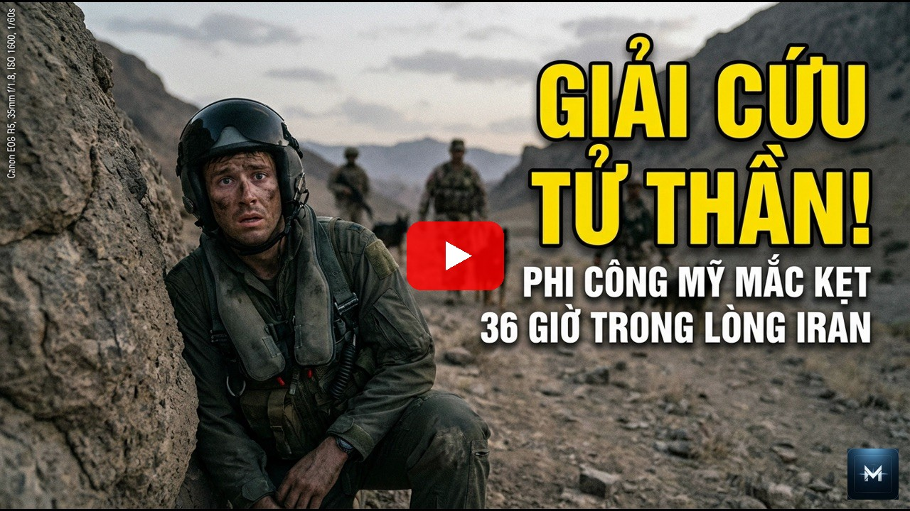

<p align="center">
  <a href="#license"></a>
  
  
  
</p>

> [!IMPORTANT]
> This is an **actively maintained fork of [crisng95/flowkit](https://github.com/crisng95/flowkit)** focused on keeping the Google Flow integration working against live frontend/API changes and making Flow practical as a self-hosted server API. Upstream remains the original project and receives compatible fixes through pull requests when possible.

> **Current Flow integration.** Google Flow moved generation to signed-in
> `flow.google.com` batchexecute requests in September 2026. This fork keeps
> server-facing API compatibility while adapting to the browser transport.
> Project-less API requests use a session-project lease; pinning
> `FLOW_PROJECT_ID` is optional for legacy/internal callers.
>
> **Video export:** Native 1080p export uses `p0UkFb` with
> `veo_3_1_upsampler_1080p`. This path was previously live-verified by the fork,
> but must be smoke-tested again after upgrading the integrated code.
> 4K availability depends on the account and has not been re-verified.
> Veo reference-to-video and first+last-frame chaining remain unsupported
> unless a compatible live payload is confirmed (Omni Flash supports these modes).
> Image model nicknames track upstream changes, including BELUGA for
> Nano Banana 2.1; explicit wire model IDs remain available.

- **live compatibility fixes** based on current `flow.google.com` behavior;
- **self-hosted FastAPI endpoints** for server-side apps, bots and agents;
- automatic Flow project creation and short-lived session projects — no permanent `FLOW_PROJECT_ID` pin required;
- Nano Banana image generation, editing and export;
- Omni Flash text-to-video, first-frame, first+last-frame and reference-image video modes;
- Veo image-to-video support;
- real Flow credit balance / generation-cost metadata;
- persistent signed-in Chrome profile with automatic Flow tab recovery;
- generation throttling and circuit-breaker behavior for Google risk / unusual-activity responses;
- caller attribution and diagnostics for production integrations;
- regression tests built from live Flow request captures.

The goal is simple: **when Flow changes, fix the integration quickly and upstream the reusable parts.**

## AI Agent Support

<p align="center">
  
  &nbsp;&nbsp;&nbsp;&nbsp;
  
  &nbsp;&nbsp;&nbsp;&nbsp;
  
  &nbsp;&nbsp;&nbsp;&nbsp;
  
</p>

FlowKit's 36 skills (`skills/fk-*.md`) are plain Markdown recipes any AI coding
agent can read and follow. Review providers are swappable at runtime
(`agent/providers.json`, or `/fk-change-provider`) — no restart needed.

| Agent | Skills | Video review provider |
|-------|--------|----------------------|
| **Muse** | Native — reads `skills/fk-*.md` directly, vision on files and contact sheets (`muse.read`) | `muse` (= the agent itself) — official opt-in self-review: no CLI, no model, no API key; score sheets by hand via `review-sheets` → `review-submit` |
| **Claude Code** | Auto-loaded via `CLAUDE.md`, native `/fk-*` slash commands | `claude` — default `video_review` role |
| **Codex CLI** | Reads `skills/fk-<name>.md` via `AGENTS.md`; vision on contact sheets for self-review | `codex` — OpenAI Codex CLI, or `muse` (= the agent itself) for hand scoring |
| **agy** (Google Antigravity) | Reads skill files manually; vision on contact sheets for self-review | `agy` — Antigravity CLI, or `muse` (= the agent itself) for hand scoring |

## Showcase

| Capability | Status |
|---|---|
| Nano Banana Pro image generation | ✅ Live tested |
| Nano Banana 2 image generation | ✅ Live tested |
| Nano Banana 2 Lite wire support | ✅ Supported |
| Image references / base-image editing | ✅ Supported |
| Image export | ✅ 2K; 4K where the account/plan allows it |
| Omni Flash text-to-video | ✅ 4 / 6 / 8 / 10 s, 360p / 720p |
| Omni Flash first-frame video | ✅ Live tested |
| Omni Flash first + last frame | ✅ Supported |
| Omni Flash reference / ingredients video | ✅ Supported |
| Veo image-to-video | ✅ Supported |
| Video export / upscale | ✅ 1080p; higher modes depend on Flow/account support |
| Flow project creation | ✅ Automatic |
| Session-scoped projects | ✅ Automatic rotation after idle period |
| Account / credit inspection | ✅ Supported |
| Server REST API | ✅ FastAPI |

### Full Video Demos

<p align="center">
  <a href="https://youtu.be/DNroTtRKyUM">
    
  </a>
  <a href="https://youtu.be/KhCj_zjbSps">
    
  </a>
</p>
<p align="center">
  <a href="https://youtu.be/DNroTtRKyUM">▶️ <b>Watch: F-15E Pilot Rescue (36 Hours Evading)</b></a>
  &nbsp;&nbsp;•&nbsp;&nbsp;
  <a href="https://youtu.be/KhCj_zjbSps">▶️ <b>Watch: Hormuz Strait (US Navy vs 6 Attack Boats)</b></a>
</p>

### Generated YouTube Thumbnails

<p align="center">
  <a href="https://youtu.be/KhCj_zjbSps"></a>
  <a href="https://youtu.be/DNroTtRKyUM"></a>
</p>
<p align="center">
  
  
</p>
<p align="center">
  
  
</p>

FlowKit runs a local/server FastAPI service next to a persistent Chrome session signed into Google Flow.

The reference image system keeps characters consistent across an entire video. Each character is generated once as a reference, then the AI uses that reference in every scene — maintaining the same face, clothing, and features.

**Doctor character** — same face, glasses, white coat across 4 different scenes:

<p align="center">
  
  
  
  
</p>

**Defector character** — same face across ICU, hospital, interview, and Seoul streets:

<p align="center">
  
  
  
  
</p>

<sub>All frames from a single 50-scene project. Both characters maintain consistent appearance across completely different settings and lighting conditions — powered by the reference image system.</sub>

### F-15E Rescue — Full Story Arc (25 scenes)

<p align="center">
  
  
  
</p>
<p align="center">
  
  
  
</p>

<sub>Strategic briefing → pilot departure → formation flight → aircraft hit → CSAR alert → pilot survival. • <a href="https://youtu.be/DNroTtRKyUM">Watch full video on YouTube ▶</a></sub>

### Hormuz Strait — Naval Scenes

<p align="center">
  
  
</p>
<p align="center">
  
  
</p>

<sub>Iranian patrol boats → bridge alert → CIWS engagement → sunset patrol. • <a href="https://youtu.be/KhCj_zjbSps">Watch full video on YouTube ▶</a></sub>

### What the Pipeline Produces

Each project goes through: **story → entities → reference images → scene images → 8s video clips → narration (TTS) → concat → thumbnails → YouTube upload** — all orchestrated via API or AI agent skills.

| Output | Description |
|--------|-------------|
| Reference images | One per character/location/prop — maintains visual consistency |
| Scene images | Composed using all referenced entities |
| 8-second video clips | Generated from scene images with camera motion + sound effects |
| 4K upscale | Optional upscale to 4K resolution |
| Narrator TTS | Voice-cloned narration per scene |
| Final video | All clips concatenated, trimmed to narrator timing |
| Thumbnails | YouTube-optimized with text overlays + branding |
| YouTube metadata | SEO-optimized title, description, tags, hashtags |

---

### Chrome Extension — Live Dashboard

<p align="center">
  
</p>

<sub>The Chrome extension runs alongside Google Flow — showing real-time request log (614 total, 328 success), video generation progress, and token status. The Python agent communicates with the extension via WebSocket to automate all API calls.</sub>

---

### Web Dashboard — Ops Console

A local React dashboard (`dashboard/`) for monitoring and driving the pipeline — real-time KPIs, per-video stage progress, a scene-level pipeline view with AI review, and a setup guide, all backed by the same FastAPI agent. Supports English, Vietnamese, Hindi, Indonesian, Chinese, Korean, and Japanese.

<p align="center">
  
</p>

<p align="center">
  
  
</p>

<p align="center">
  
  
</p>

## Architecture

```
┌──────────────────┐     WebSocket      ┌──────────────────────┐     ┌──────────────────┐
│  Python Agent    │◄──────────────────►│  Chrome Extension     │────►│  flow.google.com │
│  (FastAPI+SQLite)│    localhost:9222  │  (MV3 Service Worker) │     │  (signed-in tab) │
│                  │                    │                       │     │                  │
│  - REST API :8100│  ── envelopes ──►  │  - reCAPTCHA mint     │     │  batchexecute    │
│  - Queue worker  │  ◄── responses ──  │  - runs the RPC in    │     │  cookie + `at`   │
│  - Post-process  │                    │    the page's world   │     │                  │
│  - SQLite DB     │                    │                       │     │                  │
└──────────────────┘                    └──────────────────────┘     └──────────────────┘
```

The browser keeps the authenticated Flow session and page state. FlowKit turns that into a usable local/server API for other software.

> **September 2026 — Flow moved.** It now lives at `flow.google.com` and the old
> `aisandbox-pa.googleapis.com` REST API has no caller: the `Bearer ya29.…` it
> needed stopped being minted. If you are upgrading from an older Flow Kit,
> reload the extension (v0.3.2+) and pin `FLOW_PROJECT_ID` — see
> [Configuration](#configuration). The REST path has been removed; `git log`
> has it if a payload is ever needed for reference.

### 1. Clone this maintained fork

```bash
git clone https://github.com/Bl0ck154/flowkit.git
cd flowkit
```

### 2. Install

```bash
./setup.sh
```

Or install the Python dependencies manually:

```bash
python3 -m venv venv
source venv/bin/activate
pip install -r requirements.txt
```

You also need Chrome/Chromium and `ffmpeg` for the full media pipeline.

### 3. Load the Chrome extension

Open:

```text
chrome://extensions
```

Enable **Developer mode** → **Load unpacked** → select `extension/`.

Then open `https://flow.google.com/` and sign in to the Google account you want FlowKit to use.

### 4. Start FlowKit

```bash
source venv/bin/activate
python -m agent.main
```

Default API:

```text
http://127.0.0.1:8100
```

Check it:

```bash
curl http://127.0.0.1:8100/health
curl http://127.0.0.1:8100/api/flow/status
```

You **do not need to manually pin one permanent Flow project** for normal direct API usage. FlowKit can create and rotate session projects itself, while callers can still explicitly reuse an existing `project_id` when they need long-lived project context.

**Using the Muse provider (`muse2api`)?** It needs a second service: the
[muse2api](https://github.com/crisng95/muse2api) gateway, cloned from its own
repo and started separately (default `http://127.0.0.1:18610`), with
`MUSE2API_URL` / `MUSE2API_KEY` exported before step 4. The Flow tab and
extension are not needed for muse2api requests. Full setup:
[Muse Media Provider](#muse-media-provider-provider-muse2api).

### Configuration

| Env var | Default | What it does |
|---------|---------|--------------|
| `FLOW_PROJECT_ID` | — | The Flow project every RPC is scoped to. Required. |
| `FLOW_ALLOW_DEGRADED` | `0` | `1` lets scene chaining and r2v fall back to plain i2v instead of failing. |
| `FLOW_GENERATION_MAX_CONCURRENT` / `FLOW_GENERATION_MIN_INTERVAL_S` | `1` / `3` | Every CAPTCHA-bearing Flow generation submit is serialised and spaced by at least this many seconds. |
| `FLOW_UNUSUAL_ACTIVITY_COOLDOWN_S` | `3600` | After Google answers `PUBLIC_ERROR_UNUSUAL_ACTIVITY`, no generation is submitted for this long. The hold is saved to `flow_generation_hold.json` and survives a restart; see [Account safety](#account-safety). |
| `DEFAULT_PAYGATE_TIER` | `PAYGATE_TIER_TWO` | Carried for the DB and dashboard; no longer selects a model. |
| `MEDIA_PROVIDER` | `flow` | `flow` (Google Flow via extension) or `assistant` (route all generation to the AI assistant). |
| `ASSISTANT_PROVIDER_TIMEOUT_S` | `1800` | How long a request waits for a worker to complete its provider job before failing. |
| `ASSISTANT_PROVIDER_POLL_S` | `15` | How often to poll the provider-job row while waiting for completion. |
| `MUSE2API_URL` | — | Base URL of a running [muse2api](https://github.com/crisng95/muse2api) gateway — a separate service you start from its own repo (see [Muse Media Provider](#muse-media-provider-provider-muse2api)). Setting it makes the `muse2api` provider available. |
| `MUSE2API_KEY` | — | The gateway's `MUSE2API_API_KEY` (sent as `Authorization: Bearer`). |
| `MUSE2API_IMAGE_MODEL` / `MUSE2API_VIDEO_MODEL` | `muse-image` / `muse-video` | Model ids sent to the gateway. |
| `MUSE2API_VIDEO_SECONDS` | `8` | Clip length requested for i2v. |
| `MUSE2API_TIMEOUT_S` | `1800` | Max wait for one image call or video task (covers the gateway's own account failover). |
| `MUSE2API_POLL_S` | `5` | Video task poll interval. |
| `MUSE2API_MAX_CONCURRENT` / `MUSE2API_COOLDOWN_S` | `2` / `0` | Worker throttling for this provider. |
| `MUSE2API_ALLOW_DEGRADED` | `0` | `1` renders chained scenes and r2v as plain i2v (muse.ai takes a first frame only). |

### Assistant Media Provider (`MEDIA_PROVIDER=assistant`)

Routes every generation call — reference images, scene images, edits, i2v, r2v —
to the AI assistant instead of Google Flow. No Chrome extension or Flow sign-in
needed; the worker, skills, dashboard, and concat pipeline work unchanged.

Protocol (persistent provider-job queue + HTTP API):

1. Each request is inserted as a `QUEUED` row in the `provider_job` table with the
   full prompt, orientation, input URLs (`source_url` for edits, `start_url`/`end_url`
   for video, `extra.reference_urls` for reference images).
2. An external worker (the assistant) long-polls
   `GET /api/provider-jobs/wait-next?provider=assistant&worker_id=<id>`, claims the
   job (lease granted), heartbeats while working, and finishes with
   `POST /api/provider-jobs/{id}/complete` carrying
   `{"worker_id": "<id>", "result": {"output_url": "<file:// or https:// URL>", "media_id": "<uuid>"}}`
   (or `/fail` with `{"worker_id": "<id>", "error": "..."}`).
   Only the lease holder may heartbeat/progress/complete/fail (409 otherwise);
   complete/fail are idempotent for the holder.
3. The provider mints a UUID `media_id` when the worker omits one and records the
   output URL — the DB rows look identical to Flow-generated ones, so concat and
   upload keep working. Expired leases are reclaimable, so crashed workers never
   strand jobs.

See `agent/worker/assistant_worker.py` for a reference worker implementing the
worker side of the protocol. Video upscale is not supported on this provider and
fails loudly.

### Muse Media Provider (`provider: muse2api`)

Renders through a [muse2api](https://github.com/crisng95/muse2api) gateway, which
exposes the muse.ai web app as an OpenAI-compatible API:

```
Flow Kit worker ──> Muse2APIProvider ──HTTP──> muse2api service ──> muse.ai
     (this repo, :8100)                      (separate repo, :18610)
```

> **muse2api is a separate service — Flow Kit does not ship or start it.**
> Flow Kit only contains the client (`agent/services/muse2api_client.py`) and
> the provider adapter. Before using `provider: muse2api` you must clone the
> [muse2api repo](https://github.com/crisng95/muse2api), start its server, and
> keep it running alongside the Flow Kit server. With no gateway running, every
> muse2api request fails with `muse2api connection_error`.

#### 1. Start the muse2api service (from its own repo)

```bash
git clone https://github.com/crisng95/muse2api.git
cd muse2api
python3 -m venv .venv && source .venv/bin/activate    # Python 3.10+
pip install -e .
cp .env.example .env
```

Edit `.env`:

| Variable | Set to | Why |
|----------|--------|-----|
| `MUSE2API_DRIVER` | `browser` | The default `mock` returns fake media — fine for a dry run, useless for real renders. |
| `MUSE2API_CHROMIUM_PATH` | path to Chromium/Chrome (or leave empty to auto-detect) | The browser driver drives muse.ai through Chromium. |
| `MUSE2API_API_KEY` | any secret | Flow Kit sends it as `MUSE2API_KEY`. Left empty, one is generated into `data/api_key`. |
| `MUSE2API_HOST` | `0.0.0.0` only if Flow Kit runs on another machine | Default `127.0.0.1` accepts local connections only. |

Start it and leave it running (its own terminal, tmux, or a service manager):

```bash
python -m muse2api                         # → http://127.0.0.1:18610
# or, from the same folder: docker compose up -d --build   (binds 0.0.0.0:18610)
```

Import at least one logged-in muse.ai account — the gateway renders nothing
without one. Export the cookies `hatch_sess`, `hatch_gw`, `hatch_vml` and
`hatch_native_auth_device` from a browser signed in to muse.ai:

```bash
KEY=$(cat data/api_key)   # or your MUSE2API_API_KEY
curl http://127.0.0.1:18610/admin/accounts \
  -H "Authorization: Bearer $KEY" -H "Content-Type: application/json" \
  -d '{"label":"acc1","cookies":{"hatch_sess":"...","hatch_gw":"...","hatch_vml":"...","hatch_native_auth_device":"..."}}'

curl -s http://127.0.0.1:18610/readyz
# {"ready": true, "driver": {...}, "accounts": {"available": 1, ...}}
```

`ready: false` or `accounts.available: 0` means Flow Kit requests will fail with
`no_account_available` — fix the gateway first. Account management, renewal and
the rest of the gateway's options are documented in the muse2api README.

#### 2. Point Flow Kit at it

Set these before starting the Flow Kit server (they are read once at startup —
restart after changing them):

```bash
export MUSE2API_URL=http://127.0.0.1:18610          # where the gateway listens
export MUSE2API_KEY=<the gateway's MUSE2API_API_KEY>
export DEFAULT_PROVIDER=muse2api                    # optional: make it the default
```

Check that Flow Kit sees it:

```bash
curl -s http://127.0.0.1:8100/api/providers/status   # muse2api → "available": true
```

`available: true` only means `MUSE2API_URL` is set — Flow Kit does not probe the
gateway. Use `/readyz` above to confirm the service itself is up.

#### 3. Use it

Pass `"provider": "muse2api"` on any request (or rely on `DEFAULT_PROVIDER`).
Flow Kit calls `POST /v1/images/generations` for images and `POST /v1/videos` +
`GET /v1/videos/{id}` for i2v, sends input frames inline as data URLs (so the
gateway may run on another host), and downloads every result into
`output/_shared/muse2api/` as a `file://` URL with a minted UUID `media_id` —
so `/fk-refresh-urls` is never needed for it.

Supports image and i2v; no edit, upscale or TTS, and no end frame or r2v unless
`MUSE2API_ALLOW_DEGRADED=1`. Entity reference images are sent with each scene
image (up to four, inline as data URLs; extra refs are dropped and logged), and
a ref that cannot be read fails the job rather than rendering the scene without
its character.

If the gateway runs with billing enabled, every call is charged to the wallet of
the key in `MUSE2API_KEY`. Use the admin key or a key marked `unlimited` for
Flow Kit. Troubleshooting lives in `/fk-provider` and `/fk-doctor`.

### Post-production (provider-neutral)

Concat, finalize, and review work on clips from any provider — each clip is
normalized to H.264/yuv420p + AAC before merging, so Flow and assistant clips
can be mixed in one timeline.

```bash
# Merge scene clips in display_order; trim to the video's target_duration_s
curl -X POST http://127.0.0.1:8100/api/videos/<VID>/concat \
  -H "Content-Type: application/json" \
  -d '{"orientation": "VERTICAL", "target_duration_s": 60}'

# Concat + optional music/narration mix, marks the video COMPLETED
curl -X POST http://127.0.0.1:8100/api/videos/<VID>/finalize \
  -H "Content-Type: application/json" \
  -d '{"orientation": "VERTICAL", "target_duration_s": 60,
       "music_path": "/path/to/music.mp3", "narrate": true}'

# Review scene videos, then auto-enqueue REGENERATE_VIDEO for bad scenes
# (bounded: at most max_regenerations regen requests per scene, ever)
curl -X POST http://127.0.0.1:8100/api/videos/<VID>/review-regenerate \
  -H "Content-Type: application/json" \
  -d '{"project_id": "<PID>", "mode": "light", "max_regenerations": 1}'
```

`target_duration_s` can also be stored on the video itself (`POST /api/videos`
/ `PATCH /api/videos/<VID>`) — concat/finalize fall back to it when the
request omits a target. Review accepts `file://` clip URLs directly, so
assistant-provider output needs no download step; the Flow `get_media`
fallback only runs when the extension is connected.

### Image API

The migrated image path supports Nano Banana Pro (`GEM_PIX_2`, the default),
Nano Banana 2.1 (`BELUGA`, plus `BELUGA_THINKING_LOW/MED/HIGH`) and Nano Banana 2
Lite (`HARBOR_SEAL`), all five current aspect ratios, 1-4 outputs, true
base-image editing and native 2K image export. Nano Banana 2 (`NARWHAL`) answers
`[5] NOT_FOUND` since October 2026, so the `NANO_BANANA_2` nickname now maps to
`BELUGA`; switch with `/fk-change-model`. Exact future Flow image model wire ids pass through
without being silently replaced by the default model. See
[`docs/IMAGE_API.md`](docs/IMAGE_API.md).

### Upload images from API callers

External callers should upload bytes instead of passing caller-local filesystem paths. The recommended direct-file endpoint is multipart:

```bash
curl -X POST http://127.0.0.1:8100/api/flow/upload-image-file \
  -F 'file=@./source.jpg;type=image/jpeg'
```

JSON-only clients can use `POST /api/flow/upload-image` with `image_base64`. Base64 costs roughly 33% more request bytes than multipart, but avoids filesystem visibility problems.

`file_path` remains a server-local convenience mode only. The path is opened by the FlowKit service user, so it must be readable and visible inside that service's namespace. In systemd deployments with `PrivateTmp=yes`, a caller's `/tmp/...` is not the same `/tmp` seen by FlowKit. Permission failures return 403; paths invisible in the service namespace return a descriptive 404.

When `project_id` is omitted on the maintained session-project path, the upload uses/creates the current Flow session project.

### What does not work on the new API yet

Three capabilities have no captured payload, so they fail with
`UNSUPPORTED_ON_BATCH_API` rather than quietly producing the wrong thing:

| Capability | Status | Workaround |
|---|---|---|
| 4K/1080p upscale (`/fk-pipeline` last step) | unported | none — keep the 1080p render |
| Veo reference-to-video (r2v) | unported | Omni r2v (`model_family=omni_flash`), or `FLOW_ALLOW_DEGRADED=1` → i2v off the first reference |
| Veo start+end-frame chaining (`/fk-gen-chain-videos`) | unported | Omni first+last (`model_family=omni_flash`), or `FLOW_ALLOW_DEGRADED=1` → i2v off the start frame |
| Omni Flash text-to-video | ported | `POST /api/flow/generate-video-omni-text` (4/6/8/10s) |
| Omni Flash frame / first+last / reference modes | ported | `eb1hJf`, `nprQif`, `MZZa6b` — `POST /api/flow/generate-video` with `model_family=omni_flash` |

Restoring one starts with a capture, not a guess: [`docs/CAPTURE.md`](docs/CAPTURE.md).

## End-to-End Example: "Pippip the Fish Merchant"

A chubby cat sells fish at a market. 3 scenes, vertical, Pixar 3D style.

### How it works (read this first)

The system uses **reference images** to keep visuals consistent across scenes. Here's the mental model:

**1. Identify every visual element** that should look the same across scenes:
- Characters → `entity_type: "character"` (portrait reference)
- Places → `entity_type: "location"` (landscape reference)
- Important objects → `entity_type: "visual_asset"` (detail reference)

**2. Describe ONLY appearance** in the entity `description` — this generates the reference image:
- `"Chubby orange tabby cat with blue apron, straw hat"` (what it looks like)

**3. Write scene prompts as ACTION** — reference entities by name, describe what they DO:
- `"Pippip stands behind Fish Stall, arranging fish..."` (what happens)
- NOT: `"A chubby orange tabby cat wearing a blue apron stands behind a wooden stall..."` (don't repeat appearance)

**4. List all entities that appear** in each scene's `character_names` array — their reference images get passed to the AI as visual input, ensuring consistency.

```
Story idea
    ↓
Break into visual elements → characters[] array with entity_type + description
    ↓
Write scene prompts using entity NAMES → character_names lists which refs to use
    ↓
System generates ref image per entity → then composes scenes using those refs
```

### Using Skills (recommended)

Skills handle all the API calls, polling, and verification automatically. Use with Claude Code (`/fk-command`) or follow the recipe in `skills/*.md` for any AI agent.

```
/fk-create-project             ← interactive: asks story, creates entities + scenes
/fk-gen-refs <project_id>      ← generates all reference images, verifies UUIDs
/fk-gen-images <pid> <vid>     ← generates scene images with all refs applied
/fk-gen-videos <pid> <vid>     ← generates videos (2-5 min each, polls automatically)
/fk-concat <vid>               ← downloads + merges into final video
/fk-status <pid>               ← dashboard: what's done, what's next
```

Full pipeline in 5 commands. Each skill pre-checks dependencies (e.g. `/fk-gen-images` verifies all refs exist first).

### Manual API (step by step)

<details>
<summary>Click to expand raw curl commands</summary>

#### Step 1: Create project with reference entities

From the story, identify every visual element that repeats across scenes:

| Element | entity_type | description (appearance only) |
|---------|-------------|-------------------------------|
| Pippip | `character` | Chubby orange tabby cat, big green eyes, blue apron, straw hat |
| Fish Stall | `location` | Rustic wooden stall, thatched roof, ice display |
| Open Market | `location` | Southeast Asian market, colorful awnings, lanterns |
| Golden Fish | `visual_asset` | Golden koi, shimmering scales, magical glow |

```bash
curl -X POST http://127.0.0.1:8100/api/flow/generate-image \
  -H 'Content-Type: application/json' \
  -d '{
    "prompt": "cinematic product photo of a red ceramic mug on a white table",
    "image_model": "NANO_BANANA_2",
    "aspect_ratio": "IMAGE_ASPECT_RATIO_LANDSCAPE",
    "count": 1
  }'
```

Available configured image families include:

```text
NANO_BANANA_PRO
NANO_BANANA_2
NANO_BANANA_2_LITE
```

See [`docs/IMAGE_API.md`](docs/IMAGE_API.md) for image references, editing, aspect ratios and export.

### Omni Flash text-to-video

```bash
curl -X POST http://127.0.0.1:8100/api/flow/generate-video-omni-text \
  -H 'Content-Type: application/json' \
  -d '{
    "prompt": "slow cinematic camera push toward a coffee cup by a rainy window",
    "duration_s": 4,
    "resolution": "360p",
    "aspect_ratio": "VIDEO_ASPECT_RATIO_LANDSCAPE"
  }'
```

### Upload an image

For **external/API callers**, send the image bytes directly. Do not pass a path from the caller's filesystem: `flowkit-agent.service` runs as its own `flowkit` user and uses systemd isolation such as `PrivateTmp=yes`, so caller-local `/tmp/...`, `/root/...` and other protected paths may not exist or be readable inside the service.

## Core Concepts

### Reference Image System

Every visual element that should stay consistent gets a **reference image** — characters, locations, props. Each reference has a UUID `media_id` used in all scene generations via `imageInputs`.

| Entity Type | Aspect Ratio | Composition |
|-------------|-------------|-------------|
| `character` | Portrait | Full body head-to-toe, front-facing, centered |
| `location` | Landscape | Establishing shot, level horizon, atmospheric |
| `creature` | Portrait | Full body, natural stance, distinctive features |
| `visual_asset` | Portrait | Detailed view, textures, scale reference |

### Scene Prompts = Action Only

Scene prompts describe **what happens**, not character appearance. The reference images maintain visual consistency.

```
DO:   "Pippip juggling fish at Fish Stall, crowd watching in Open Market"
DON'T: "Pippip the chubby orange tabby cat wearing a blue apron juggling..."
```

### Media ID = UUID

All `media_id` values are UUID format (`xxxxxxxx-xxxx-xxxx-xxxx-xxxxxxxxxxxx`). Never the base64 `CAMS...` mediaGenerationId.

### Two Prompts per Scene

Each scene has **two separate prompts**:
- `prompt` — describes the **still image** (frame 0): `"Luna steps out of rocket onto candy planet. Wide shot, sunrise."`
- `video_prompt` — describes the **8s video motion** with sub-clip timing and camera directions:

```
0-3s: Wide crane down, Luna steps out of rocket onto Candy Planet Surface. Luna gasps "It's beautiful!"
3-6s: Low angle tracking shot, Luna walks across candy ground, shallow DOF. Luna says "Everything is made of candy."
6-8s: Close-up Luna's face, eyes wide with wonder, golden hour backlight. Silence, ambient wind.
```

### Character Voice

Characters can have a `voice_description` (max ~30 words) for voice consistency:
```json
{"name": "Luna", "entity_type": "character", "description": "Small white cat...", "voice_description": "Soft curious childlike voice with wonder and slight purring"}
```

Voice descriptions are auto-appended to video prompts before generation.

### No Background Music

The worker auto-appends `"No background music. Keep only natural sound effects and ambient sounds."` to all video prompts. Sound effects from the scene (footsteps, splashing, wind) are preserved.

## Pipeline Overview

```
1. Create project      POST /api/projects (with entities + story)
2. Create video        POST /api/videos
3. Create scenes       POST /api/scenes (chain_type: ROOT → CONTINUATION)
4. Gen ref images      POST /api/requests {type: GENERATE_CHARACTER_IMAGE} per entity
   → Wait ALL complete, verify all have UUID media_id
5. Gen scene images    POST /api/requests {type: GENERATE_IMAGE} per scene
   → Wait ALL complete
6. Gen videos          POST /api/requests {type: GENERATE_VIDEO} per scene
   → Wait ALL complete (2-5 min each)
7. (Optional) Upscale  POST /api/requests {type: UPSCALE_VIDEO} (TIER_TWO only)
8. Download + concat   ffmpeg normalize + concat
```

## Skills (AI Agent Workflows)

Ready-to-use workflow recipes in `skills/` (also available as `/slash-commands` in Claude Code):

### Basic Pipeline

| Skill | Description |
|-------|-------------|
| `/fk-create-project` | Create project + entities + video + scenes interactively |
| `/fk-research` | Fact-check story details before scripting |
| `/fk-gen-refs` | Generate reference images for all entities |
| `/fk-gen-images` | Generate scene images with character refs |
| `/fk-gen-videos` | Generate videos from scene images (4K upscale via `UPSCALE_VIDEO` request, `PAYGATE_TIER_TWO`) |
| `/fk-concat` | Download + merge all scene videos |
| `/fk-pipeline` | Smart full-pipeline orchestrator — runs the whole chain end to end |
| `/fk-monitor` | Live monitor for a running pipeline |

### Advanced Video

| Skill | Description |
|-------|-------------|
| `/fk-gen-chain-videos` | Auto start+end frame chaining for smooth transitions (i2v_fl) |
| `/fk-insert-scene` | Multi-angle shots, cutaways, close-ups within a chain |
| `/fk-creative-mix` | Analyze story + suggest all techniques (chain, insert, r2v, parallel) |

### Review & Quality

| Skill | Description |
|-------|-------------|
| `/fk-review-video` | AI vision scoring of generated scene videos (quality, consistency, usability) — see [AI Vision Providers](#ai-vision-providers-video-review) below |
| `/fk-review-board` | Visual scene-by-scene review board for feedback before locking a cut |
| `/fk-change-provider` | View/switch the reviewer (`muse` = the assistant itself, or an AI CLI), model and effort behind `/fk-review-video` |

### Reference

| Skill | Description |
|-------|-------------|
| `/fk-camera-guide` | Camera angles, movements, lighting, DOF for cinematic video prompts |
| `/fk-thumbnail-guide` | Hook-worthy thumbnail design rules |
| `/fk-provider` | Media providers: choose the generation backend (`flow`/`assistant`), run the assistant worker, troubleshoot provider jobs |

### TTS & Narration

| Skill | Description |
|-------|-------------|
| `/fk-gen-tts-template` | Create a voice template for consistent narration |
| `/fk-import-voice` | Import an existing voice recording as a template |
| `/fk-gen-narrator` | Generate narrator text + TTS for all scenes |
| `/fk-gen-text-overlays` | Generate text overlays from narrator text (dates, locations, stats) |
| `/fk-concat-fit-narrator` | Trim scene videos to fit narrator duration, then concat |
| `/fk-gen-music` | Generate background music via Suno |

### YouTube

| Skill | Description |
|-------|-------------|
| `/fk-youtube-seo` | Generate SEO-optimized title, description, tags |
| `/fk-brand-logo` | Apply channel icon watermark to video/thumbnails |
| `/fk-youtube-upload` | Upload to YouTube with rule validation + scheduling |
| `/fk-thumbnail` | Generate YouTube-optimized thumbnails |

### Utilities

| Skill | Description |
|-------|-------------|
| `/fk-status` | Full project dashboard + recommended next action |
| `/fk-switch-project` | Switch the active project |
| `/fk-fix-uuids` | Repair any CAMS... media_ids to UUID format |
| `/fk-refresh-urls` | Refresh expired GCS signed URLs for images/videos |
| `/fk-upload-image` | Upload a local image to get a `media_id` |
| `/fk-add-material` | Image material system |
| `/fk-change-model` | View/switch video, image, and upscale model keys |
| `/fk-dashboard` | Live status in the Claude Code statusline |
| `/fk-doctor` | Diagnose any error (Flow API, extension, worker, YouTube) and prescribe a fix |

### Muse Support

Muse is a first-class FlowKit agent, not just another skill reader:

- **Skills run natively** — no shelling out, no slash-command wiring.
  Muse reads `skills/fk-*.md` and calls its own tools directly, including
  vision on files (`muse.read` for contact sheets and images).
- **`muse` is an official video-review provider** — no CLI, no model, no API
  key. The key means "the agent itself": Muse, Codex, or agy scores review
  contact sheets by hand with its own vision through
  `POST .../review-sheets` → vision → `POST .../review-submit`
  (see `/fk-review-video --by muse`). Opt in per role with
  `/fk-change-provider set muse`; the default role stays on `claude`.

### AI CLI Compatibility (Skill Consumption)

Skills are `.md` recipes any AI coding-assistant CLI can read and follow — this is about **which agent reads the skill files**, not which model does the work:

| CLI | Instructions | How skills work |
|-----|-------------|-----------------|
| Muse | Skills auto-loaded | Native tool calls (`muse.read` for files/images) |
| Claude Code | `CLAUDE.md` (auto-loaded) | Native `/fk-*` slash commands |
| Codex CLI | `AGENTS.md` → reads `CLAUDE.md` | User says `/fk-<name>`, agent reads `skills/fk-<name>.md` |

The Gemini CLI target was dropped in v1.3.1 — the CLI is retired, and its
replacement `agy` reads none of what that target generated (see the changelog).
`agy` is still supported, as one of the three CLIs that can run video review —
that is configured in `agent/providers.json`, not by `setup.py`.

### AI Vision Providers (Video Review)

Separate from the table above — this is about **which backend does the vision analysis** for `/fk-review-video`. Four reviewers are supported and swappable at runtime, no restart required:

| Provider | Binary | Reasoning efforts | Model catalog | Setup |
|----------|--------|-------------------|---------------|-------|
| `muse` | — (the assistant itself) | — | — | Official — Muse reads the contact sheets with its own vision via `POST .../review-sheets` → `POST .../review-submit`; no CLI, no API key. Opt in per role (`/fk-change-provider set muse`) |
| `claude` | Claude Code CLI | `low` `medium` `high` `xhigh` `max` | aliases (`sonnet`, `opus`, `haiku`, `fable`) or any full model name | Install the CLI, sign in once |
| `agy` | Google Antigravity CLI | `low` `medium` `high` | closed — `agy models` is the whole list and agy rejects anything else | Install separately, sign in once |
| `codex` | OpenAI Codex CLI | `low` `medium` `high` `xhigh` `max` (varies per model) | codex's own on-disk cache, plus slugs newer than it | `npm install -g @openai/codex`, then `codex login` once |

Provider, model and effort are set **per role** — a role being a job an AI
does for Flow Kit. There is one today, `video_review`; the config is a map so
the next one is an entry rather than a schema change. Model and effort may both
be `null`, meaning "whatever that backend defaults to". The `muse` reviewer
takes no model or effort — it is Muse scoring contact sheets by hand, so
pointing `video_review` at `muse` disables the CLI review endpoint (it
answers 500 with directions) and the review flow becomes
`review-sheets` → hand scoring → `review-submit`.

**For `agy`, model and effort are mutually exclusive.** Its slugs name their own
effort — `gemini-3.8-flash-low`, `gemini-3.1-pro-high` — so setting both is
rejected (`--model gpt-oss-120b-medium conflicts with --effort=low`), and a slug
with no effort in its name refuses `--effort` outright
(`--effort is not supported for model "claude-sonnet-4-6"`). Pick a model, or
pick an effort and let agy choose the model. The API answers 400 for the pair.

```bash
# View provider status + the current per-role config
#   live=true additionally runs `<binary> --version` on each (a few seconds)
curl -s "http://127.0.0.1:8100/api/providers?live=true" | python3 -m json.tool

# List a provider's models (refresh=true bypasses the 5-minute cache)
curl -s "http://127.0.0.1:8100/api/providers/models?provider=agy" | python3 -m json.tool

# Point a role at a provider/model/effort — hot-reloaded, no server restart
curl -X PATCH http://127.0.0.1:8100/api/providers \
  -H "Content-Type: application/json" \
  -d '{"roles": {"video_review": {"provider": "claude", "model": "sonnet", "effort": "high"}}}'

# agy takes a model OR an effort, never both — its slugs name their own effort
curl -X PATCH http://127.0.0.1:8100/api/providers \
  -H "Content-Type: application/json" \
  -d '{"roles": {"video_review": {"provider": "agy", "model": "gemini-3.8-flash-low"}}}'

# The older whole-agent switch still works. It also clears each role's model
# (a slug means nothing to a different CLI) and drops an effort the new
# provider does not have.
curl -X PATCH http://127.0.0.1:8100/api/providers \
  -H "Content-Type: application/json" -d '{"active": "agy"}'
```

Or edit it in the dashboard under **Settings**, or run `/fk-change-provider` for
an interactive picker. Full details in `skills/fk-change-provider.md`.

**`codex` needs credits on its OpenAI workspace.** `installed: true` only means
the binary is on PATH; a workspace with no balance fails every review with
`ERROR: Your workspace is out of credits`.

**Contact sheets lose their timestamps on an ffmpeg without `libfreetype`.**
Homebrew's ffmpeg 8.x is one such build: `drawtext` is simply absent, and
naming a filter that does not exist aborts the whole chain. Flow Kit probes for
it once and falls back to untimestamped frames, telling the model the frame
interval instead so it can still answer in time ranges. `ffmpeg -filters | grep
drawtext` shows whether yours has it.

## Video Generation Techniques

| Technique | API Type | Use Case |
|-----------|----------|----------|
| **i2v** | `GENERATE_VIDEO` | Image → video (standard) |
| **i2v_fl** | `GENERATE_VIDEO` + endImage | Start+end frame → smooth scene transitions |
| **r2v** | `GENERATE_VIDEO_REFS` | Reference images → video (intros, dream sequences) |
| **Upscale** | `UPSCALE_VIDEO` | Video → 4K (TIER_TWO only) |

## API Reference

### CRUD Endpoints

| Resource | Create | List | Get | Update | Delete |
|----------|--------|------|-----|--------|--------|
| Project | `POST /api/projects` | `GET /api/projects` | `GET /api/projects/{id}` | `PATCH /api/projects/{id}` | `DELETE /api/projects/{id}` |
| Character | `POST /api/characters` | `GET /api/characters` | `GET /api/characters/{id}` | `PATCH /api/characters/{id}` | `DELETE /api/characters/{id}` |
| Video | `POST /api/videos` | `GET /api/videos?project_id=` | `GET /api/videos/{id}` | `PATCH /api/videos/{id}` | `DELETE /api/videos/{id}` |
| Scene | `POST /api/scenes` | `GET /api/scenes?video_id=` | `GET /api/scenes/{id}` | `PATCH /api/scenes/{id}` | `DELETE /api/scenes/{id}` |
| Request | `POST /api/requests` | `GET /api/requests` | `GET /api/requests/{id}` | `PATCH /api/requests/{id}` | — |

### Special Endpoints

| Endpoint | Description |
|----------|-------------|
| `GET /health` | Server + extension status |
| `GET /api/flow/status` | Extension connection details |
| `GET /api/flow/credits` | User credits + tier |
| `GET /api/requests/pending` | Pending request queue |
| `GET /api/projects/{id}/characters` | Entities linked to project |

### Request Types

| Type | Required Fields | Async? | reCAPTCHA? |
|------|----------------|--------|------------|
| `GENERATE_CHARACTER_IMAGE` | character_id, project_id | No | Yes |
| `GENERATE_IMAGE` | scene_id, project_id, video_id, orientation | No | Yes |
| `GENERATE_VIDEO` | scene_id, project_id, video_id, orientation | Yes | Yes |
| `GENERATE_VIDEO_REFS` | scene_id, project_id, video_id, orientation | Yes | Yes |
| `UPSCALE_VIDEO` | scene_id, project_id, video_id, orientation | Yes | Yes |

## Worker Behavior

- **Server handles throttling** — worker enforces max 5 concurrent + 10s cooldown automatically. Use `POST /api/requests/batch` to submit all at once; do NOT manually batch.
- **10s cooldown** between API calls (anti-spam, configurable via `API_COOLDOWN`)
- **Reference blocking** — scene image gen refuses if any referenced entity is missing `media_id`
- **Skip completed** — won't re-generate already-completed assets
- **Cascade clear** — regenerating image auto-resets downstream video + upscale
- **Retry** — failed requests retry up to 5 times, except the account-safety cases below
- **UUID enforcement** — extracts UUID from fifeUrl if response doesn't provide it directly
- **Voice context** — auto-appends character `voice_description` to video prompts
- **No background music** — auto-appends "no background music, keep sound effects" to all video prompts
- **Dual video response schema** — Lite/Fast/Ultra models return `operations[]` and stream URLs; Low Priority models (`veo_3_1_*_low_priority`, `*_ultra_relaxed`) return `workflows + media` with the MP4 inline as base64. The SDK auto-detects, validates the `ftyp` magic, and saves the binary to `output/_workflow_videos/{media_id}.mp4`. The scene's `_video_url` is then a `file://` path which `curl` and `ffmpeg` handle natively. `_video_media_id` always stores the real Flow media UUID, so upscale works for both schemas.

### Account safety

Some users reported Google accounts whose manual Flow UI generation was refused
after FlowKit testing ([#67](https://github.com/crisng95/flowkit/issues/67)).
Submitting more generations into a Google anti-abuse block may prolong it, so
FlowKit stops instead of retrying:

- **`PUBLIC_ERROR_UNUSUAL_ACTIVITY`** (any spelling) fails the request at once
  and holds every further generation submit for `FLOW_UNUSUAL_ACTIVITY_COOLDOWN_S`
  (1 hour by default). The hold is written to `flow_generation_hold.json`, so
  restarting the agent does not lift it. Media reads and polling keep working.
- **`[HIJACK] extension_hijack_detected`** (the reCAPTCHA bypass failed) pauses
  submits for 30s and is retried at most 3 times, then the request fails.
- `GET /api/flow/status` → `generation_throttle` shows whether a hold is active,
  its reason and the seconds left. `POST /api/flow/clear-hijack` lifts it by
  hand — only do that once manual generation in the Flow UI works again.

### Default Model & Tier Compatibility

The default for `PAYGATE_TIER_TWO` `frame_2_video` and `start_end_frame_2_video` is `veo_3_1_i2v_lite_low_priority` — the TRUE 0-credit Low Priority that works on every service tier including `SERVICE_TIER_ADVANCED`.

The `*_ultra_relaxed` family (Low Priority ultra-quality) silently returns empty operations on `SERVICE_TIER_ADVANCED` accounts because Google requires `SERVICE_TIER_ULTRA` for that path. ULTRA-tier users can switch back via `/fk-change-model` — see `skills/fk-change-model.md` for the full preset list and tier compatibility matrix.

## Material System

Every project must have a `material` field that controls the visual style of generated images. Set it at project creation.

```bash
curl -X POST http://127.0.0.1:8100/api/flow/upload-image-file \
  -F 'file=@./source.jpg;type=image/jpeg' \
  -F 'project_id=YOUR_FLOW_PROJECT_ID'
```

If `project_id` is omitted, FlowKit automatically uses/creates the current session project.

#### JSON/base64 upload

| Variable | Default | Description |
|----------|---------|-------------|
| `API_HOST` | `127.0.0.1` | REST API bind address |
| `API_PORT` | `8100` | REST API port |
| `WS_HOST` | `127.0.0.1` | WebSocket server bind |
| `WS_PORT` | `9222` | WebSocket server port |
| `POLL_INTERVAL` | `5` | Worker poll interval (seconds) |
| `MAX_RETRIES` | `5` | Max retries per request |
| `VIDEO_POLL_TIMEOUT` | `420` | Video gen poll timeout (seconds) |
| `API_COOLDOWN` | `10` | Seconds between API calls (anti-spam) |

## Architecture

```
agent/
├── main.py              # FastAPI app + WebSocket server
├── config.py            # Configuration (loads models.json, providers.json)
├── models.json          # Video/upscale/image model mappings
├── providers.json        # Per-role AI CLI provider/model/effort (claude/agy/codex)
├── db/
│   ├── schema.py        # SQLite schema (aiosqlite)
│   └── crud.py          # Async CRUD with column whitelisting
├── models/              # Pydantic models + Literal enums
├── api/                 # REST routes (projects, videos, scenes, characters, requests,
│                         #   flow, models, providers, reviews, materials, music, tts)
├── services/
│   ├── flow_client.py   # WS bridge to extension
│   ├── tts.py           # OmniVoice TTS (subprocess-based)
│   ├── scene_chain.py   # Continuation scene logic
│   ├── cli_providers.py  # What each AI CLI accepts; role → provider/model/effort
│   ├── video_reviewer.py # AI vision review — contact sheet + claude/agy/codex CLI dispatch
│   └── post_process.py  # ffmpeg trim/merge/music
└── worker/
    └── processor.py     # Queue processor + poller

extension/               # Chrome MV3 extension
skills/                  # AI agent workflow recipes (CLI-agnostic)
youtube/
├── auth.py              # OAuth2 multi-channel auth
├── upload.py            # Upload with scheduling + rule validation
└── channels/            # Per-channel config (gitignored)
    └── <channel_name>/
        ├── client_secrets.json  # OAuth2 credentials
        ├── token.json           # Auth token (auto-created)
        ├── channel_rules.json   # Upload rules + SEO defaults
        └── upload_history.json  # Upload log
CLAUDE.md                # AI agent instructions (Claude Code)
AGENTS.md                # AI agent instructions (Codex CLI, generated)
```

## TTS Narration (OmniVoice)

Optional narrator voice for scenes. Uses [OmniVoice](https://github.com/tuannguyenhoangit-droid/OmniVoice) — multilingual zero-shot TTS with voice cloning (600+ languages).

### Setup

See `skills/fk-gen-tts-template.md` for full install guide. Quick version:

```bash
IMAGE_B64="$(base64 -w0 ./source.jpg)"
curl -X POST http://127.0.0.1:8100/api/flow/upload-image \
  -H 'Content-Type: application/json' \
  -d "{\"image_base64\":\"$IMAGE_B64\",\"mime_type\":\"image/jpeg\",\"file_name\":\"source.jpg\"}"
```

Base64 is supported for compatibility and JSON-only clients, but expands the request by roughly one third compared with multipart.

#### Server-local `file_path` mode

`file_path` remains available as a convenience **only when the image already exists on the FlowKit server** and is readable by the `flowkit` service user:

```bash
curl -X POST http://127.0.0.1:8100/api/flow/upload-image \
  -H 'Content-Type: application/json' \
  -d '{
    "file_path": "/var/lib/flowkit/imports/source.jpg",
    "file_name": "source.jpg"
  }'
```

Do not use caller-local `/tmp/...` paths for this mode. With systemd `PrivateTmp=yes`, the FlowKit service sees a different `/tmp` namespace. Unreadable paths return a clear 403, and paths not visible in the service namespace return a descriptive 404 instead of an internal traceback.

The response contains a Flow `media_id` and the resolved `project_id`, both of which can be reused for later generation.

### Image-to-video with Omni Flash

```bash
curl -X POST http://127.0.0.1:8100/api/flow/generate-video \
  -H 'Content-Type: application/json' \
  -d '{
    "start_image_media_id": "YOUR_MEDIA_ID",
    "scene_id": "demo-scene",
    "prompt": "slow camera pan, natural subtle motion",
    "model_family": "omni_flash",
    "duration_s": 4,
    "resolution": "360p",
    "aspect_ratio": "VIDEO_ASPECT_RATIO_LANDSCAPE"
  }'
```

For first+last frame and multi-reference / Ingredients modes, see [`docs/OMNI_FLASH.md`](docs/OMNI_FLASH.md).

### Read the active Google account

```bash
curl http://127.0.0.1:8100/api/flow/account
```

### Read Flow credits

```bash
curl http://127.0.0.1:8100/api/flow/credits
```

Force a visible Flow balance refresh:

```bash
curl 'http://127.0.0.1:8100/api/flow/credits?refresh=true'
```

Generation responses can also include the current balance, estimated generation cost and estimated remaining balance.

| Reason string | Meaning | Auto-handling |
|---------------|---------|---------------|
| `PUBLIC_ERROR_UNSAFE_GENERATION` | Prompt tripped safety filter (people, violence, nudity) | Mark FAILED — rewrite prompt (use alias names, remove triggers) |
| `PUBLIC_ERROR_USER_QUOTA_REACHED` | Daily credits exhausted | Mark FAILED — wait for reset or upgrade tier |
| `PUBLIC_ERROR_MODEL_ACCESS_DENIED` | Tier mismatch (e.g. TIER_ONE trying Veo 3 / upscale) | Mark FAILED — auto-detect should downgrade to allowed model |
| `Requested entity was not found` | Uploaded `media_id` expired (~1h TTL) | Auto-recover via `_recover_entity_not_found` — re-uploads from `image_url`, re-queues PENDING |
| `Internal error encountered` | Flow backend transient 500 | Exponential backoff retry: `2^retry * 10s`, capped 300s |
| `reCAPTCHA failed` / `captcha` | Extension couldn't solve CAPTCHA | Retry up to 10× without incrementing `retry_count` (processor.py:454-464) |
| `PUBLIC_ERROR_UNUSUAL_ACTIVITY` (403, message `reCAPTCHA evaluation failed`) | Google flagged the session as bot-like — usually rapid bursts of submits, VPN/shared IP, or stale auth cookies | NOT auto-recoverable. Pause submits, clear cookies for `google.com` + `labs.google` in Chrome, sign back in at `flow.google.com`, then resubmit with ≥1s gap and ≤5 concurrent. See `/fk-doctor` for full playbook. |

Older FlowKit versions commonly relied on one permanently pinned `FLOW_PROJECT_ID`. That becomes increasingly awkward for server workloads because unrelated jobs accumulate in the same Flow project.

| Status | Source | Meaning | Handling |
|--------|--------|---------|----------|
| **400** | Flow API | Invalid payload, UNSAFE_GENERATION, entity not found (sometimes) | Route by `details.reason` — some are auto-recoverable, others terminal |
| **401** | Flow API | Should not occur — batchexecute authenticates in the page, not with a bearer | Check the Flow tab is signed in; see `NO_AT_TOKEN` |
| **403** | Extension (`background.js:432`) | `CAPTCHA_FAILED`, `NO_FLOW_TAB`, or `MODEL_ACCESS_DENIED` | CAPTCHA → retry loop; NO_FLOW_TAB → fail (user must open Flow); tier → fail |
| **404** | Flow API | `media_id` not found (expired upload) | Same as "Requested entity was not found" — auto re-upload |
| **429** | Flow API | Rate limited / quota | Back off + retry; if `USER_QUOTA_REACHED` appears, fail |
| **500** | Flow backend **or** extension fetch exception (`background.js:504`) | Transient server error OR network drop during fetch | Retry with exponential backoff |
| **502** | FastAPI default (`agent/api/flow.py:80,92`) | Extension returned error without explicit status | Retry; check extension health |
| **503** | FastAPI (`api/flow.py`) | "Extension not connected" | Worker waits for reconnect — status set to PENDING, not FAILED |
| **504** | Agent | 60s timeout waiting for extension WS response | Treated as transient; re-queue PENDING |

- **no `project_id` supplied** → FlowKit uses a session project and rotates it after idle time;
- **explicit `project_id` supplied** → FlowKit reuses that exact Flow project;
- higher-level applications can persist an order/job → Flow project mapping and reopen it days later for revisions.

This makes the API suitable for queues, ecommerce workflows, bots and other multi-job systems without losing the ability to return to old Flow projects.

## Production behavior

| Error message contains | Cause | Handling |
|-----------------------|-------|----------|
| `Extension not connected` | Chrome extension offline or WS dropped | 503 returned; worker re-queues PENDING and waits |
| `extension reconnected` / `extension disconnected` | WS bounce mid-request | Re-queue PENDING without incrementing `retry_count` |
| `extension_switched` | User switched Flow tabs mid-generation | Re-queue PENDING |
| `NO_AT_TOKEN` | Flow tab is signed out, on an interstitial, or still booting | Open `flow.google.com`, sign in, let the app load |
| `NO_FLOW_PROJECT` | No Flow project to scope the RPC to | Pin `FLOW_PROJECT_ID` — **terminal, not retried** |
| `UNSUPPORTED_ON_BATCH_API` | Upscale / r2v / chaining — payload never captured | See `docs/CAPTURE.md` — **terminal, not retried** |
| `NO_FLOW_TAB` | No Google Flow tab available for reCAPTCHA | User must open a Flow tab |
| `Failed to fetch` | Network drop inside extension service worker | Retry with backoff |
| `timeout` / WS 60s no response | Extension hung mid-request | Re-queue PENDING |

- generation submissions are serialized by default;
- minimum spacing between generation launches;
- `PUBLIC_ERROR_UNUSUAL_ACTIVITY` is treated as a terminal/risk response instead of being blindly retried;
- a short local circuit breaker prevents a failing caller from hammering Flow;
- optional `X-FlowKit-Caller` identifies the integration that triggered a request without logging prompts or media contents;
- `/api/flow/status` exposes generation-guard and session state;
- the Flow tab can close after idle time and be reopened using the persistent browser profile when needed.

## Live API compatibility

Flow's internal request shapes are positional and can change. This fork keeps captured request builders and regression tests for the modes it automates.

Recent examples of live fixes include:

- current Flow project creation RPC;
- Omni Flash 360p model / option slots;
- updated first-frame full-frame crop structure;
- trusted browser interaction for media selection and generation recovery;
- image upload by direct bytes for external callers;
- credit/account visibility and generation-cost estimates.

The capture methodology is documented in [`docs/CAPTURE.md`](docs/CAPTURE.md).

## Dashboard and full video pipeline

FlowKit is more than the low-level API. The repository also contains the original project/dashboard pipeline for multi-scene generation, references, review and post-processing.

<p align="center">
  
</p>

The low-level REST API can be used independently by your own application, while the higher-level pipeline remains available for larger video workflows.

## Maintained fork vs upstream

This repository started as a fork of **[crisng95/flowkit](https://github.com/crisng95/flowkit)** and keeps the MIT license and upstream attribution.

The projects currently have different maintenance focuses:

| This fork | Upstream |
|---|---|
| Fast live fixes for `flow.google.com` request changes | Original project and broader pipeline direction |
| Server/API integrations and production diagnostics | Video-review/provider tooling and general project features |
| Project/session lifecycle automation | Upstream baseline architecture |
| Credit/account inspection | Original documentation and ecosystem |
| Compatibility patches are submitted upstream when portable | Reviews/merges compatible contributions |

This is **not** intended to erase or replace upstream credit. If you need the original project, use upstream. If you want the compatibility-focused version actively run and updated against live Flow, use this fork.

Current upstream compatibility work is also submitted back through pull requests where practical.

## Automatic compatibility monitoring

Every normal trusted-UI generation now doubles as a **zero-extra-credit compatibility check**. FlowKit captures the actual `f.req` sent by the current Flow UI, strips prompts, media/project IDs, UUIDs, reCAPTCHA/opaque values and random seeds, then compares the remaining structure with the request builder that initiated the job.

`GET /api/flow/status` exposes the latest sanitized `payload_drift` state. Structural changes such as a moved crop slot, changed client descriptor or new resolution flag are logged as `PAYLOAD_DRIFT` without storing the sensitive request payload.

Near-term roadmap:

- automated regression-test / patch branches for simple, whitelisted wire-format changes;
- optional GitHub PR creation when a safe structural patch is inferred and the full suite passes;
- safer periodic upstream syncs without overwriting fork-specific server features.

The goal is to turn a future Flow frontend change from “the API is broken” into “FlowKit detected payload drift and has a tested compatibility patch ready.”

## Search keywords / use cases

FlowKit is relevant if you are looking for a:

- Google Flow API / unofficial Google Flow API;
- self-hosted Google Flow server;
- Nano Banana API or Nano Banana self-hosted automation layer;
- Omni Flash API / Omni image-to-video API;
- Veo image-to-video automation;
- AI image generation REST API;
- AI video generation REST API;
- local FastAPI bridge for Google Flow;
- server-side Flow automation for bots, agents or ecommerce pipelines.

## Important limitations

- This uses **unofficial web interfaces**, not a stable public Google API.
- Google may change Flow without notice.
- A signed-in Google Flow browser session is required.
- Your Google subscription, credit balance, model availability and regional limits still apply.
- Do not treat local cost estimates as billing guarantees; Flow remains authoritative.
- Respect Google's terms and any applicable content/usage policies.

## Contributing

Compatibility reports are most useful when they include:

- FlowKit commit SHA;
- endpoint/mode that failed;
- HTTP/error code;
- whether the same action works manually in the Flow UI;
- sanitized structural differences only — **never post cookies, auth tokens or reCAPTCHA tokens**.

If you capture a changed Flow request shape, add a regression test with the fix so the same drift does not return silently.

## Upstream

Original project: **[crisng95/flowkit](https://github.com/crisng95/flowkit)**

Thanks to the original author and contributors for the architecture this fork builds on.

## Changelog

Dates are merge dates. Older releases are tagged; `git log` is the full record.

### v1.3.1 — 2026-09-20 — the dead Gemini target

| Date | Change |
|---|---|
| 2026-09-20 | **`setup.py --tool gemini` removed.** It generated `.gemini/commands/fk/*.toml` and `GEMINI.md` for a CLI that is retired, and its replacement `agy` reads neither — verified against agy 1.2.7: a project's `.gemini/commands/*.toml` is not expanded, `.claude/commands/*.md` is not either, and `GEMINI.md`, `AGENTS.md` and `CLAUDE.md` are all absent from a print-mode run's context even inside a trusted folder. `agy plugin import` imports extensions, not command files. `GEMINI.md` is deleted; `setup.py clean` still removes what the target left on disk, because nothing else ever will. `agy` remains fully supported — as one of the three CLIs that run video review, configured in `agent/providers.json` rather than by `setup.py` |
| 2026-09-20 | **`AGENTS.md` is genuinely generated again.** It says "do not edit" and had been edited anyway: rules 14-16 (fact-check, real-people bypass, review-before-upscale) and pipeline steps 0 and 7.5 lived only in the committed artifact, so `setup.py sync` would have deleted three operational rules. They are in `setup.py` now. The same drift had left the skill table listing 25 skills — missing 11 that exist and naming one that does not; it is rebuilt from `skills/` at generation time |
| 2026-09-20 | `setup.py` gains its first tests (13), including that a `.fk-setup.json` written before this release — which records `"gemini"` — is skipped with a pointer to `clean` instead of crashing the sync |

### v1.3.0 — 2026-09-20 — video review works again

Video review had been failing on every path at once, which is why nothing about
it looked fixable from the symptoms. The unit suite was red on a normal dev
machine for the whole period — 13 of these tests fail on v1.2.0 — while CI
stayed green, because the workflow installs ffmpeg *and* a font and asserts
`drawtext` renders. The one environment that ran the suite was the one
environment where it worked.

All three providers are verified end-to-end against the real CLIs: a synthetic
clip with a planted mid-clip defect, through frame extraction, contact sheets
and a live vision call, with no mocks. claude, agy and codex each find the
defect and score it, on their default model and on an explicitly selected
model + effort.

| Date | Change |
|---|---|
| 2026-09-20 | **ffmpeg without `drawtext`**: Homebrew's ffmpeg 8.x is built without `libfreetype`, so the timestamp filter does not exist and naming it aborted the whole chain — frame extraction died before any provider was reached. Probed once, with a fallback to untimestamped frames and a prompt that hands the model the frame interval instead |
| 2026-09-20 | **`agy` was auto-denied**: handed a bare file path, agy reaches for a shell command to look at the file, headless mode cannot prompt for that permission, and the run returns an empty response on a **zero** exit code. Fixed by steering it at its own file-reading tool and naming the sheet directory with `--add-dir`, which gets the read done unprivileged — so `--dangerously-skip-permissions`, which auto-approves every tool including arbitrary shell commands, is gone. Output is parsed from `--output-format json`, and a denied tool is an error whether or not agy still answered — the prompt carries the rubric and both scene prompts, so a denied run can write a plausible review from the text alone |
| 2026-09-20 | **`codex` no longer bypasses its sandbox**: `-i` hands codex the image bytes directly, so the run needs neither a shell nor a writable filesystem. `--dangerously-bypass-approvals-and-sandbox` bought nothing and cost the sandbox; `--sandbox read-only` already implies `approval: never`. An empty output file is now an error instead of a JSON decode failure three frames away |
| 2026-09-20 | **A malformed error entry no longer vanishes.** The parser required the exact keys `severity`/`time_range`/`description` and silently dropped anything else — and what it dropped was usually CRITICAL, the one severity that caps `character_consistency` at 3.0 and forces the verdict below acceptable, so `timeRange` instead of `time_range` turned an unusable video into a clean pass. The three fields are now handled by what they can cost: near-miss names are normalised, a missing time range or description is repaired and logged, and only a severity outside `{CRITICAL, HIGH, MINOR}` fails the scene — that is the one field with no safe default, because without it we do not know whether the video passed. `VideoError.severity` is a `Literal` now, so the three code paths that branch on it cannot be handed anything else |
| 2026-09-20 | **A review with no scores in it is now a failure, not a score.** Every dimension defaults to 5.0, so a CLI answer carrying no `dimensions` became a complete, plausible review — 5.0 across the board, verdict "poor", zero errors — of a video nothing had actually looked at |
| 2026-09-20 | **stdin closed for all three CLIs.** Each appends piped stdin to the prompt when stdin is not a terminal — codex documents it as a `<stdin>` block. Under uvicorn that is whatever the launching shell handed down |
| 2026-09-20 | **Per-role provider, model and effort**, editable in the dashboard under Settings or via `PATCH /api/providers`. Efforts are validated against each CLI's real ladder (agy stops at `high`); models are validated only for agy, whose catalog is closed, so a slug newer than claude's or codex's cache still goes through. A whole-agent `{"active": …}` switch clears each role's model and clamps its effort, because neither survives a change of CLI |
| 2026-09-20 | Review hardening from an adversarial pass: one review is pinned to one provider (the role was resolved per scene, so a hand edit or a dashboard poll mid-run could split a video's score across two backends); an unknown agy model is a 400 naming the known slugs instead of a failed review; CLI failures carry stdout as well as stderr (claude puts its readable sentence there); `providers.json` is written atomically (a truncated file hard-fails `config.py` at import, so the server would not boot); and the drawtext probe is an optimisation now — extraction retries untimestamped if the filter is listed but cannot render, which is what an ffmpeg with libfreetype and no font does |
| 2026-09-20 | **agy's model and effort are mutually exclusive** and the config now says so. Its slugs name their own effort (`gemini-3.8-flash-low`), so the pair is rejected — a mismatch conflicts, and a slug with no effort in its name refuses `--effort` at all |

### v1.2.0 — 2026-09-18 — the Flow migration

Flow moved to `flow.google.com` in September 2026 and stopped minting the bearer
token the old REST API needed. Everything below is that migration.

| Date | Change |
|---|---|
| 2026-09-18 | `/health` reports the app's real version again — it had been pinned at `0.2.0` since v0.2.0 while the app said `1.1.0`, because only one of the two literals was ever bumped ([#52](../../pull/52)) |
| 2026-09-18 | Omni 1.1 Flash first-frame, first+last and reference modes ported to `batchexecute` ([#48](../../pull/48), [#50](../../pull/50)). Unported capabilities drop from four to three, all on the Veo path |
| 2026-09-17 | REST transport removed — the ten `_legacy_*` methods, the `USE_BATCH_RPC` branches, the fingerprint pools and `agent/services/headers.py`; net −1043 lines ([#49](../../pull/49)) |
| 2026-09-17 | Migrated image API: variant submit, settled-wave retry, and 2K/4K image export via `SPrCad` ([#42](../../pull/42)) |
| 2026-09-15 | Video submit unified across the frame and reference paths ([#46](../../pull/46)) |
| 2026-09-15 | Omni Flash text-to-video on the batch path ([#41](../../pull/41)) |
| 2026-09-15 | Extension: idle-tab leak fixed ([#44](../../pull/44)) |
| 2026-09-07 | `batchexecute` transport added — the agent builds the envelope, the extension signs it inside a signed-in Flow tab ([#39](../../pull/39)) |

### Earlier

| Date | Change |
|---|---|
| 2026-08-18 | Omni Flash generation ([#30](../../pull/30)); MV3 flow-key bootstrap ([#24](../../pull/24)) |
| 2026-08-04 | Web dashboard rebuilt with the real pipeline UI, a guide page and i18n |
| 2026-08-04 | Video review: contact sheets split by duration rather than one giant tile; `agy` and `codex` added as review CLI providers |
| 2026-08-04 | Skill files standardised on `fk-<name>` |
| 2026-05-09 | `v1.1.0` |
| 2026-04-27 | `v1.0.2` |
| 2026-04-22 | `v1.0.1` |

## License

MIT — see [`LICENSE`](LICENSE).
